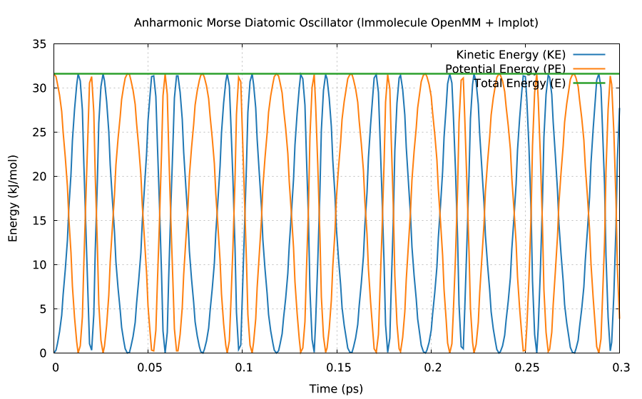

# lmmolecule

**Molecular dynamics for lmscript in one static executable: OpenMM 8 (Core API, Reference and SIMD
CPU platforms, Lepton custom potentials, PocketFFT 3D Particle Mesh Ewald, L-BFGS energy
minimization, Verlet and BAOAB Langevin middle integrators, and Monte Carlo barostat).** It is a
scripting host, not a command-line tool: write an [lmscript](https://lmctl.com/tools/lmscript/skill.html)
`_dsl_` block, compile it, run it with `lmmolecule --dsl`. No Python, no runtime plugins, no shared
libraries.

[](https://github.com/lmctl-ai/lmmolecule/actions/workflows/ci.yml)
[](LICENSE)

```
# argon-fcc.lms
p = _dsl_ cli="lmmolecule" install="github:lmctl-ai/lmmolecule@latest";
let sys = md.system().fcc(3, 0.54, 39.948).lj(0.996, 0.3405, 0.78);
let sim = sys.sim("langevin", 0.002, 120.0, 5.0, 42);
sim.minimize(0.001, 200)
   .velocities(120.0, 42)
   .report("argon.csv", 50)
   .xyz("argon.xyz", 200)
   .step(800);
end _dsl_
savedsl(p, "argon.dslb");
system ${dsl_cli(p)} --dsl argon.dslb;
```

`lmscript argon-fcc.lms` finds `lmmolecule` on `PATH` or downloads the release binary for your
platform on first use, compiles against the schema built into it, and runs the program.

## What it does

Units follow OpenMM's standard molecular dynamics convention (`nm`, `ps`, `amu` / `g/mol`,
elementary charge `e`, `K`, `kJ/mol`, radians, `bar`). User-supplied potential energy expressions
are compiled by OpenMM's embedded Lepton engine; see
[durable-memory/04-expressions.md](durable-memory/04-expressions.md).

| `md.` / `System` / `Sim` | |
| --- | --- |
| `md.system()` `md.platform("reference"\|"cpu")` | create system builder; select Reference or SIMD CPU platform |
| `sys.box` `particle` `add_particle` `pos` `vel` `count` | periodic box and explicit particles |
| `sys.fcc` `rocksalt` `gas` `load_xyz` | crystal lattices (FCC, NaCl rock-salt), seeded gas, XYZ loader |
| `sys.bond` `angle` `torsion` | harmonic bonds, harmonic angles, periodic dihedral torsions |
| `sys.lj` `lj_particle` `charge` `coulomb` `exclude` | Lennard-Jones 12-6, Coulomb (`none`/`cutoff`/`ewald`/`pme`), exclusions |
| `sys.custom_external` `custom_bond` `custom_nonbonded` | Lepton custom external traps, custom bonds, custom pair potentials |
| `sys.barostat` `sys.sim("verlet"\|"langevin", ...)` | Monte Carlo NPT barostat; Verlet or BAOAB Langevin middle integrator |
| `sim.minimize` `velocities` `step` `report` `xyz` `save_xyz` | L-BFGS minimization, Maxwell-Boltzmann seeding, CSV/XYZ reporters |
| `sim.ke` `pe` `energy` `temperature` `time` `distance` `angle_val` `box_volume` | thermodynamic observables and geometry queries |
| `md.eval(expr)` `assert_close` `print` `version` | physical constants (`pi`, `e`, `kB`, `one_4pi_eps0`), assertions, output |

Schema and rules: [durable-memory/03-schema-v0.md](durable-memory/03-schema-v0.md).

Combine it with other hosts in one script: [examples/combo/morse_plot.lms](examples/combo/morse_plot.lms)
integrates an anharmonic Morse diatomic oscillator with `lmmolecule` and plots kinetic, potential,
and total energy with [lmplot](https://github.com/lmctl-ai/lmplot) (two `_dsl_` blocks, two hosts).



## Examples

| Program | Shows |
| --- | --- |
| [argon_fcc_melt.lms](examples/argon_fcc_melt.lms) | 108-atom FCC argon crystal L-BFGS minimization + Langevin equilibration |
| [nacl_madelung.lms](examples/nacl_madelung.lms) | 512-ion NaCl rock-salt lattice PME electrostatics → Madelung constant 1.747565 |
| [butane_torsion.lms](examples/butane_torsion.lms) | united-atom butane chain with harmonic bonds/angles, 3-fold torsion, 1-4 LJ |
| [morse_dimer.lms](examples/morse_dimer.lms) | Lepton custom bond Morse potential under NVE Verlet with energy conservation check |
| [combo/morse_plot.lms](examples/combo/morse_plot.lms) | `lmmolecule` simulates, `lmplot` draws energy conservation plot |

## Build

C++17 compiler, CMake 3.24, git; nothing else.

```sh
scripts/sync-deps.sh            # OpenMM 8.2.0 at the commit in deps.lock
cmake -S . -B build && cmake --build build
./test.sh                       # needs lmscript on PATH
```

Linux builds are fully static; macOS links only system libraries; Windows links the MinGW runtime
statically. `lmmolecule --notices` prints the license texts of everything inside.

## License

MIT ([LICENSE](LICENSE)). OpenMM Core/Reference/CPU/Lepton are MIT/BSD/public-domain, PocketFFT is
BSD-3-Clause, SFMT is BSD-3-Clause, L-BFGS is MIT; see [THIRD_PARTY_NOTICES](THIRD_PARTY_NOTICES).
