# lmmolecule

Molecular dynamics with OpenMM, scripted in lmscript: worked problems with known answers, each reproduced by one runnable file.

[](https://github.com/lmctl-ai/lmmolecule/actions/workflows/ci.yml)
[](https://github.com/lmctl-ai/lmmolecule/releases)
[](LICENSE)

| Liquid water, checked against the textbook | One potential, three phases | Diffusion from the Einstein relation |
| --- | --- | --- |
| 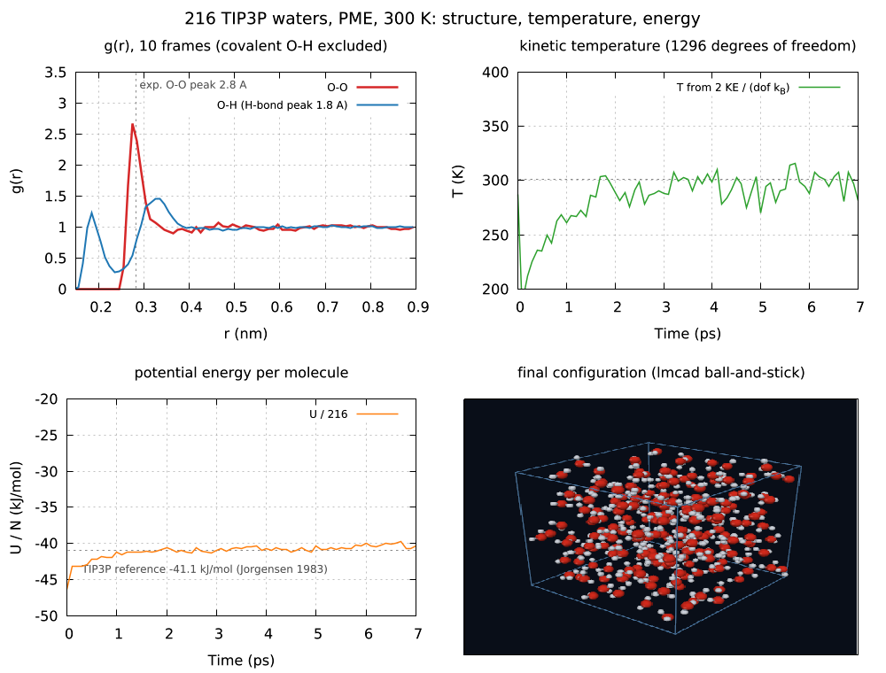 | 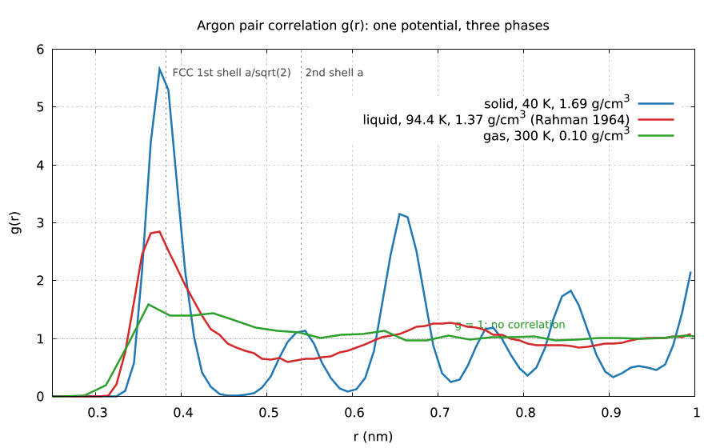 | 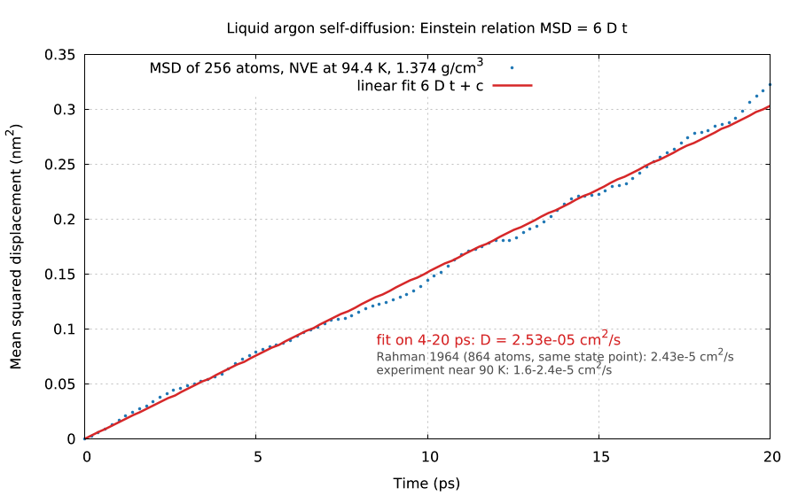 |
| [216 rigid TIP3P molecules with PME at 300 K: O-O peak at 2.75 Å, U/N = -40 kJ/mol](examples/stories/water_box.lms)<br>`lmctl https://raw.githubusercontent.com/lmctl-ai/lmmolecule/main/examples/stories/water_box.lms` | [Same 256 argon atoms as solid, liquid (Rahman 1964 state point) and gas](examples/stories/argon_rdf_phases.lms)<br>`lmctl https://raw.githubusercontent.com/lmctl-ai/lmmolecule/main/examples/stories/argon_rdf_phases.lms` | [D = 2.5e-5 cm²/s from the MSD slope; Rahman's 1964 value was 2.43e-5](examples/stories/diffusion_msd.lms)<br>`lmctl https://raw.githubusercontent.com/lmctl-ai/lmmolecule/main/examples/stories/diffusion_msd.lms` |

| The hydrogen bond TIP3P was fitted to | Melting a crystal | Phonons in a one-dimensional crystal |
| --- | --- | --- |
| 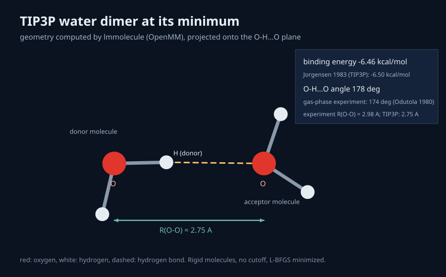 | 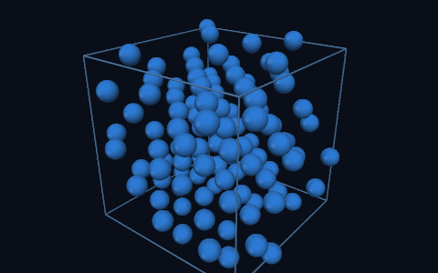 | 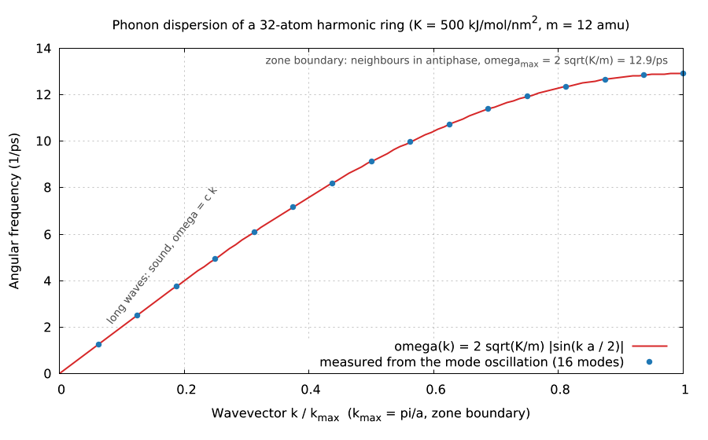 |
| [Minimized dimer: -6.46 kcal/mol at R(O-O) = 2.75 Å (Jorgensen: -6.50 at 2.74)](examples/stories/water_dimer.lms)<br>`lmctl https://raw.githubusercontent.com/lmctl-ai/lmmolecule/main/examples/stories/water_dimer.lms` | [108 atoms, 24 Langevin stages: the FCC order disappears above the melting line](examples/stories/argon_melt.lms)<br>`lmctl https://raw.githubusercontent.com/lmctl-ai/lmmolecule/main/examples/stories/argon_melt.lms` | [16 normal modes of a harmonic ring measured one by one against omega(k) = 2 sqrt(K/m) sin(ka/2)](examples/stories/phonon_dispersion.lms)<br>`lmctl https://raw.githubusercontent.com/lmctl-ai/lmmolecule/main/examples/stories/phonon_dispersion.lms` |

## Gallery by theme

Every picture is produced by the example it links to; the `lmctl autorun` line runs it from any empty
directory and writes the image under `docs/images/` there. The long-form gallery with one picture per
section is [docs/gallery.md](docs/gallery.md). The Linux binary needs glibc >= 2.35 (Ubuntu 22.04 or
newer); everything else it uses is linked in statically.

### Liquids, crystals and phase behaviour

| Density from an NPT run | Maxwell-Boltzmann speeds | Melting, before and after |
| --- | --- | --- |
| 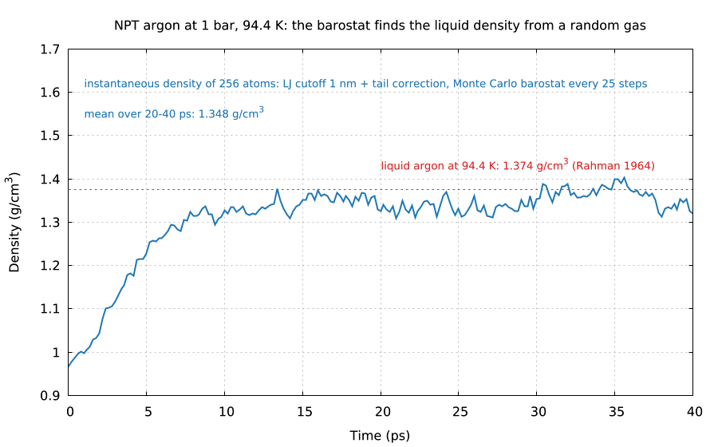 | 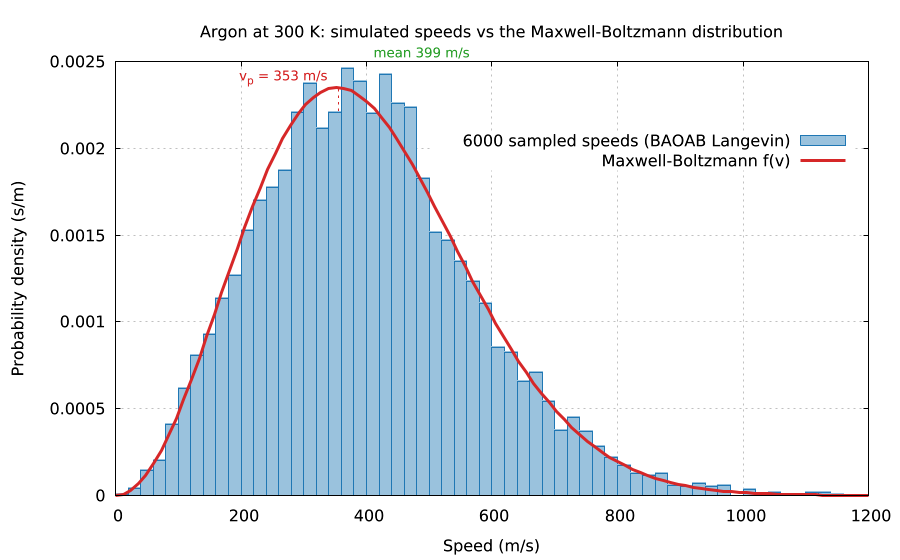 | 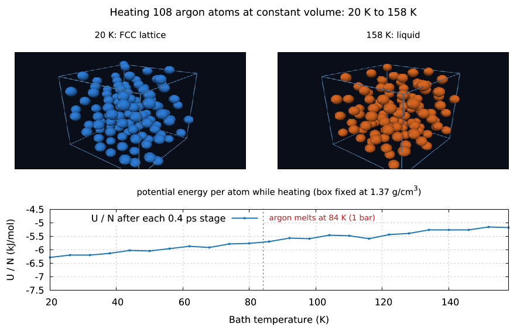 |
| [Monte Carlo barostat at 1 bar, 94.4 K, from a random gas: 1.35 g/cm³ vs 1.374 measured](examples/stories/npt_density.lms)<br>`lmctl https://raw.githubusercontent.com/lmctl-ai/lmmolecule/main/examples/stories/npt_density.lms` | [6000 sampled speeds of 1000 atoms at 300 K on the analytic f(v); v_p = 353 m/s](examples/stories/maxwell_boltzmann.lms)<br>`lmctl https://raw.githubusercontent.com/lmctl-ai/lmmolecule/main/examples/stories/maxwell_boltzmann.lms` | [Still image of the animation: lattice at 20 K, liquid at 158 K, U/N while heating](examples/stories/argon_melt.lms)<br>`lmctl https://raw.githubusercontent.com/lmctl-ai/lmmolecule/main/examples/stories/argon_melt.lms` |

| Minimized argon crystal | Thermostatted crystal |
| --- | --- |
| 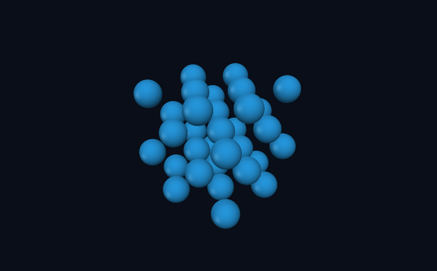 | 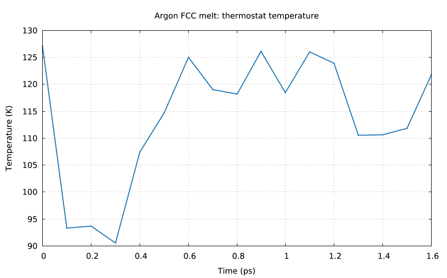 |
| [32 argon sites after L-BFGS minimization, rendered by lmcad](examples/visual/argon_structure.lms)<br>`lmctl https://raw.githubusercontent.com/lmctl-ai/lmmolecule/main/examples/visual/argon_structure.lms` | [108-atom FCC crystal: cohesive energy -7.7 kJ/mol per atom, then 120 K Langevin equilibration](examples/argon_fcc_melt.lms)<br>`lmctl https://raw.githubusercontent.com/lmctl-ai/lmmolecule/main/examples/argon_fcc_melt.lms` |

### Water

| The box behind the dashboard | Dimer energy along O-O | Forces on a bent molecule |
| --- | --- | --- |
| 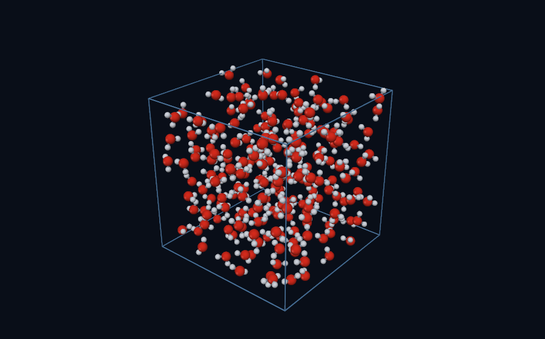 | 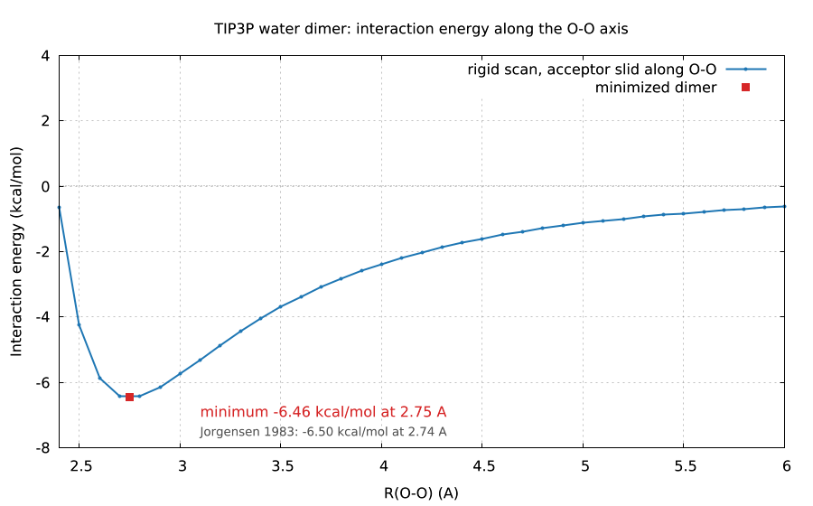 | 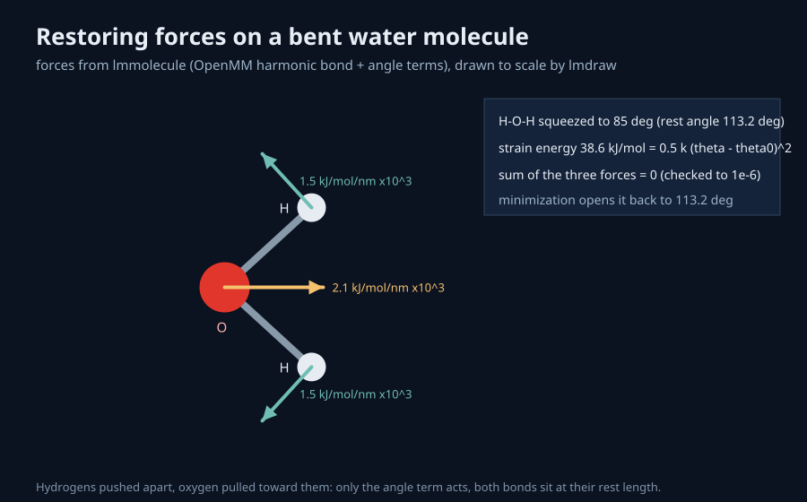 |
| [Ball-and-stick render of the equilibrated 216-molecule cell, wrapped into the box](examples/stories/water_box.lms)<br>`lmctl https://raw.githubusercontent.com/lmctl-ai/lmmolecule/main/examples/stories/water_box.lms` | [Rigid scan of the acceptor along the O-O axis through the -6.46 kcal/mol minimum](examples/stories/water_dimer.lms)<br>`lmctl https://raw.githubusercontent.com/lmctl-ai/lmmolecule/main/examples/stories/water_dimer.lms` | [Restoring forces from the angle term, drawn to scale by lmdraw; they sum to zero](examples/stories/water_forces.lms)<br>`lmctl https://raw.githubusercontent.com/lmctl-ai/lmmolecule/main/examples/stories/water_forces.lms` |

| Bending potential |
| --- |
| 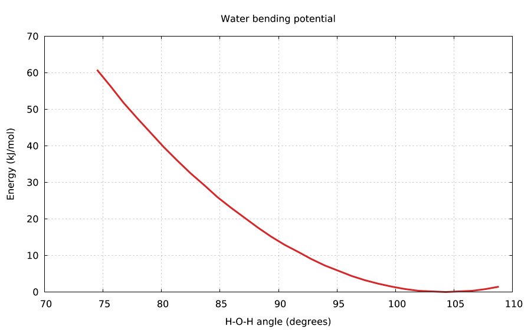 |
| [Energy of the H-O-H angle at fixed O-H lengths: a parabola around 104.5 degrees](examples/visual/water_bend.lms)<br>`lmctl https://raw.githubusercontent.com/lmctl-ai/lmmolecule/main/examples/visual/water_bend.lms` |

### Bonds, integrators and time steps

| Why MD uses a 1-2 fs step | Anharmonic period | Energy exchange in a Morse bond |
| --- | --- | --- |
| 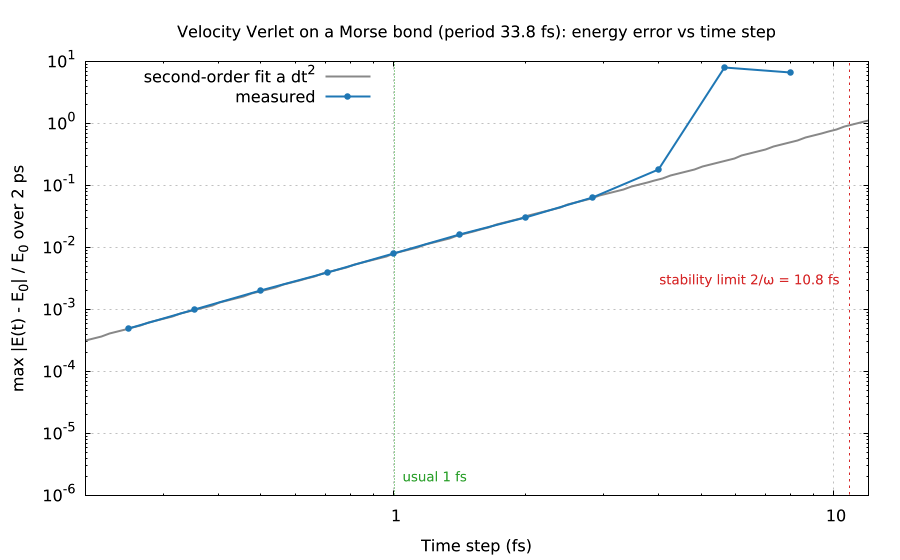 | 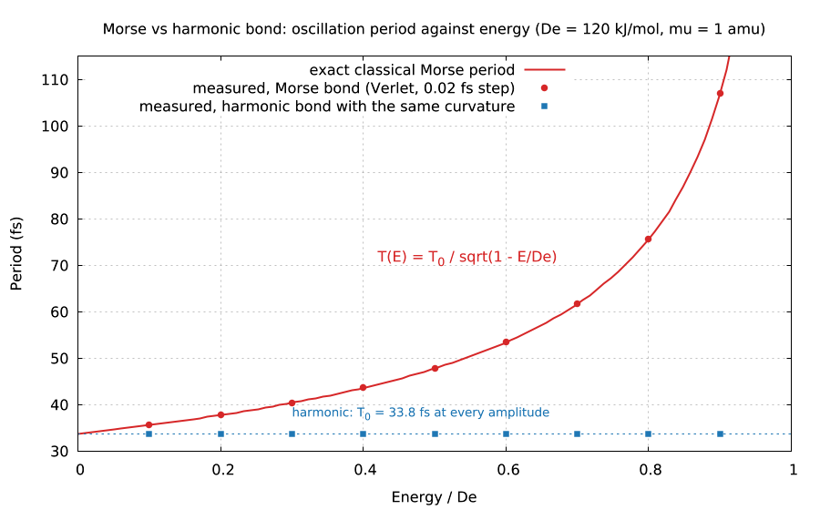 | 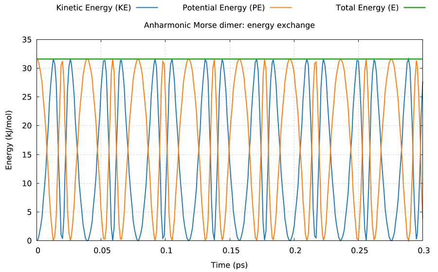 |
| [Energy error grows as dt² until the step reaches 2/omega, where Verlet goes unstable](examples/stories/timestep_convergence.lms)<br>`lmctl https://raw.githubusercontent.com/lmctl-ai/lmmolecule/main/examples/stories/timestep_convergence.lms` | [Measured Morse period follows T0/sqrt(1 - E/De) exactly; the harmonic bond keeps T0](examples/stories/morse_period.lms)<br>`lmctl https://raw.githubusercontent.com/lmctl-ai/lmmolecule/main/examples/stories/morse_period.lms` | [Two hosts in one script: lmmolecule integrates, lmplot draws; total energy stays flat](examples/combo/morse_plot.lms)<br>`lmctl https://raw.githubusercontent.com/lmctl-ai/lmmolecule/main/examples/combo/morse_plot.lms` |

| Conserved energy | Animated Morse dimer | Mass changes vibration |
| --- | --- | --- |
| 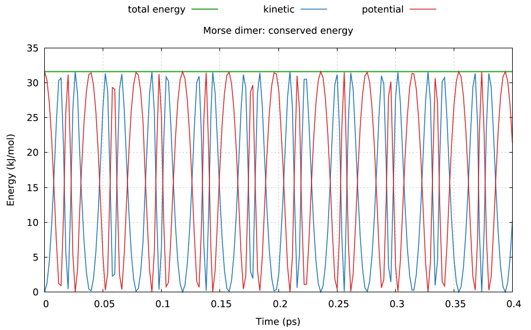 | 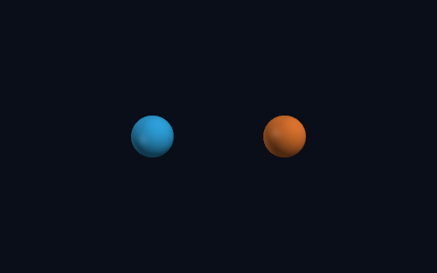 | 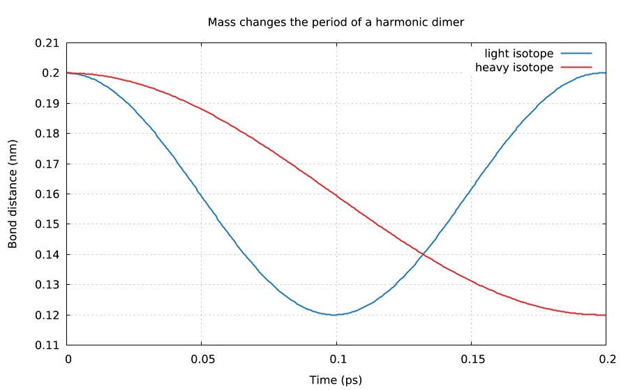 |
| [NVE Verlet on a Lepton custom bond; relative energy drift below 1e-4](examples/morse_dimer.lms)<br>`lmctl https://raw.githubusercontent.com/lmctl-ai/lmmolecule/main/examples/morse_dimer.lms` | [48 computed frames of a stretched Morse bond, rendered by lmcad](examples/visual/morse_motion.lms)<br>`lmctl https://raw.githubusercontent.com/lmctl-ai/lmmolecule/main/examples/visual/morse_motion.lms` | [Same spring, four times the mass: twice the period](examples/visual/isotope_oscillation.lms)<br>`lmctl https://raw.githubusercontent.com/lmctl-ai/lmmolecule/main/examples/visual/isotope_oscillation.lms` |

| Attraction and repulsion | Butane torsion | Butane relaxation |
| --- | --- | --- |
| 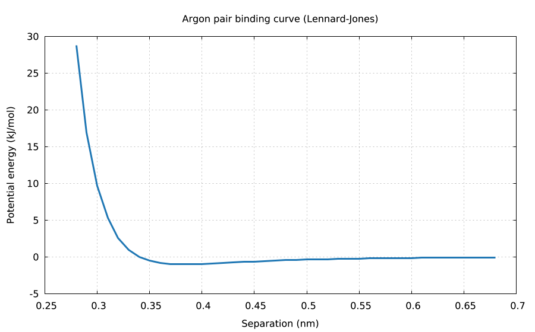 | 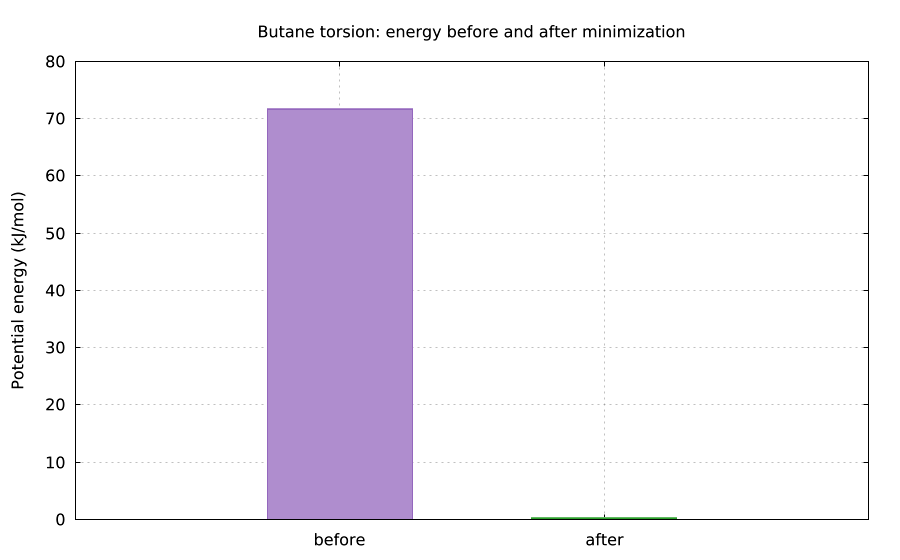 | 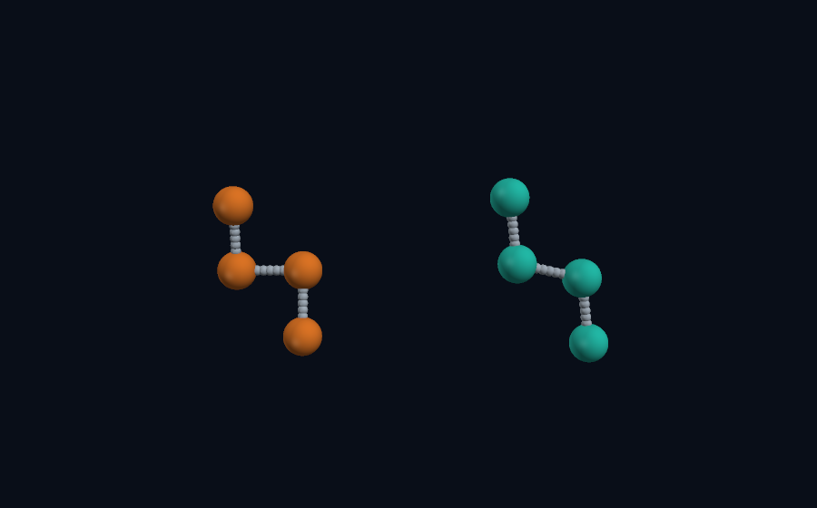 |
| [Argon pair energy against separation: the well is -epsilon at 2^(1/6) sigma](examples/visual/lj_binding.lms)<br>`lmctl https://raw.githubusercontent.com/lmctl-ai/lmmolecule/main/examples/visual/lj_binding.lms` | [United-atom butane from an eclipsed start to its trans minimum](examples/butane_torsion.lms)<br>`lmctl https://raw.githubusercontent.com/lmctl-ai/lmmolecule/main/examples/butane_torsion.lms` | [Orange initial, teal minimized chain, rendered by lmcad](examples/visual/butane_relaxation.lms)<br>`lmctl https://raw.githubusercontent.com/lmctl-ai/lmmolecule/main/examples/visual/butane_relaxation.lms` |

### Thermostats and ensembles

| NVE, Langevin and Andersen | A particle in a thermal trap |
| --- | --- |
| 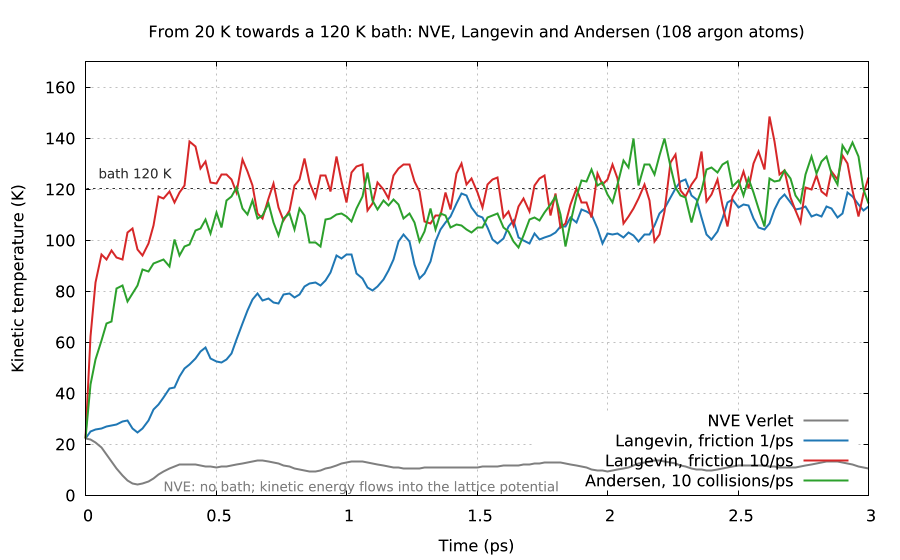 | 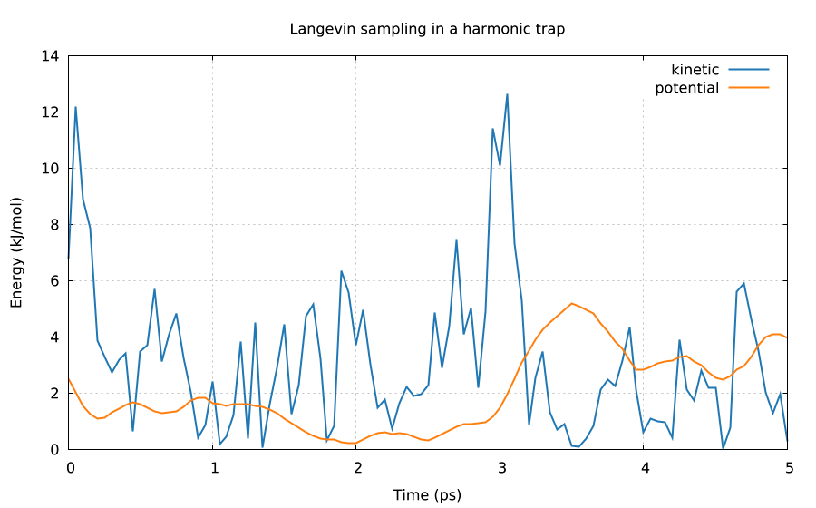 |
| [Friction 1/ps and 10/ps and 10 collisions/ps reach the bath; NVE keeps its own energy](examples/stories/thermostat_comparison.lms)<br>`lmctl https://raw.githubusercontent.com/lmctl-ai/lmmolecule/main/examples/stories/thermostat_comparison.lms` | [One argon atom in a 300 K bath samples the harmonic well](examples/visual/thermal_trap.lms)<br>`lmctl https://raw.githubusercontent.com/lmctl-ai/lmmolecule/main/examples/visual/thermal_trap.lms` |

### Lattices and electrostatics

| Madelung constant by PME | Rock-salt lattice |
| --- | --- |
| 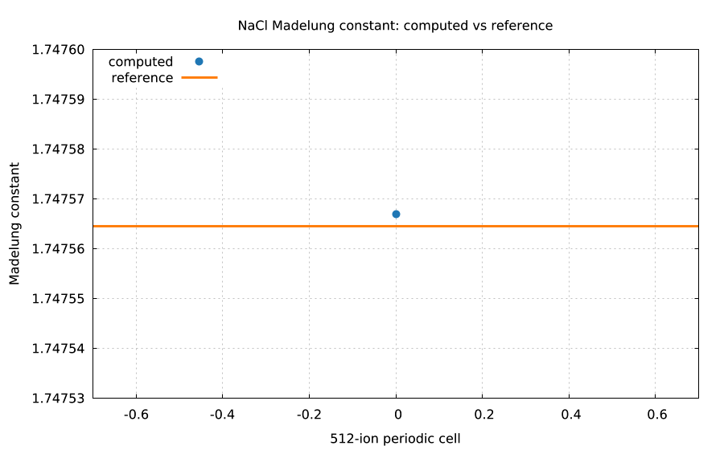 | 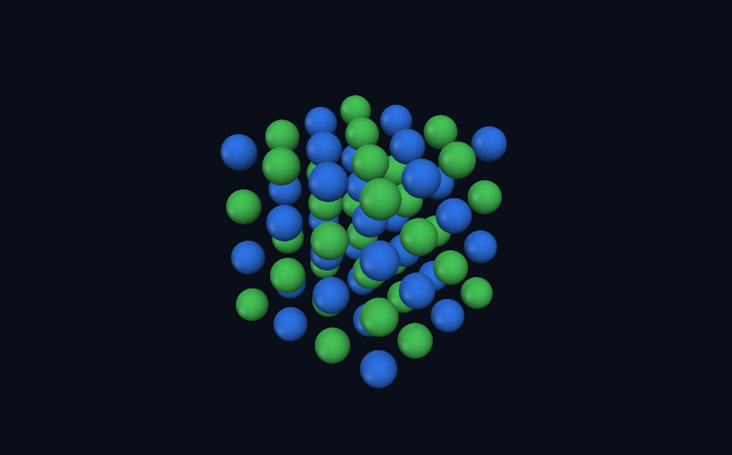 |
| [512-ion NaCl cell: M = 1.747567 by particle-mesh Ewald vs 1.7475646](examples/nacl_madelung.lms)<br>`lmctl https://raw.githubusercontent.com/lmctl-ai/lmmolecule/main/examples/nacl_madelung.lms` | [Na+ blue, Cl- green, from the charged lattice builder](examples/visual/nacl_structure.lms)<br>`lmctl https://raw.githubusercontent.com/lmctl-ai/lmmolecule/main/examples/visual/nacl_structure.lms` |

## One-minute start

Install [lmctl](https://lmctl.com/tools/lmscript/skill.html) (`npm install -g @lmctl-ai/lmctl`), then run any
caption above from an empty directory, for example:

```sh
mkdir forces && cd forces
lmctl https://raw.githubusercontent.com/lmctl-ai/lmmolecule/main/examples/stories/water_forces.lms
# -> docs/images/water_forces.png (lmmolecule computes the forces, lmdraw draws them to scale)
```

The `install=` bindings download the released hosts (`lmmolecule`, `lmplot`, `lmcad`, `lmdraw`) on first
use; binaries already on `PATH` take priority. A program of your own looks like this:

```
# argon-fcc.lms
p = _lmcode_ cli="lmmolecule" install="github:lmctl-ai/lmmolecule@latest";
let sys = md.system().fcc(3, 0.54, 39.948).lj(0.996, 0.3405, 0.78);
let sim = sys.sim("langevin", 0.002, 120.0, 5.0, 42);
sim.minimize(0.001, 200)
   .velocities(120.0, 42)
   .report("argon.csv", 50)
   .xyz("argon.xyz", 200)
   .step(800);
end _lmcode_
savedsl(p, "argon.dslb");
system ${dsl_cli(p)} --dsl argon.dslb;
```

`lmscript argon-fcc.lms` compiles the program against the schema built into the binary and runs it.
From a clone, `LMMOLECULE_TEST_NETWORK=1 examples/render-all.sh` regenerates every image in `docs/images/`.

## What it does

Units follow OpenMM's standard molecular dynamics convention (`nm`, `ps`, `amu` / `g/mol`,
elementary charge `e`, `K`, `kJ/mol`, radians, `bar`). User-supplied potential energy expressions
are compiled by OpenMM's embedded Lepton engine; see
[durable-memory/04-expressions.md](durable-memory/04-expressions.md).

| `md.` / `System` / `Sim` | |
| --- | --- |
| `md.system()` `md.platform("reference"\|"cpu")` `md.threads(n)` | create system builder; select Reference or SIMD CPU platform; CPU thread count (1 = byte-identical reruns) |
| `sys.box` `particle` `add_particle` `pos` `vel` `count` | periodic box and explicit particles |
| `sys.fcc` `rocksalt` `gas` `load_xyz` `load_pdb` | crystal lattices (FCC, NaCl rock-salt), seeded gas, XYZ and PDB coordinate loaders (element masses) |
| `sys.water(model, x, y, z)` `water_box(model, n, spacing, seed)` | rigid TIP3P / SPC/E water: one molecule, or n³ molecules in a periodic cube |
| `sys.bond` `angle` `torsion` `constrain` | harmonic bonds, harmonic angles, periodic dihedral torsions, rigid distance constraints (SHAKE/SETTLE) |
| `sys.lj` `lj_particle` `dispersion_correction` `charge` `coulomb` `dielectric` `exclude` | Lennard-Jones 12-6 with optional long-range tail correction, Coulomb (`none`/`cutoff`=`reaction_field`/`ewald`/`pme`), reaction-field dielectric (78.3; 1 = plain shifted cutoff), exclusions |
| `sys.custom_external` `custom_bond` `custom_nonbonded` | Lepton custom external traps, custom bonds, custom pair potentials |
| `sys.barostat` `andersen` `sys.sim("verlet"\|"langevin", ...)` | Monte Carlo NPT barostat, Andersen collision thermostat; Verlet or BAOAB Langevin middle integrator |
| `sim.minimize` `velocities` `step` `report` `xyz` `save_xyz` `save_pdb` | L-BFGS minimization, Maxwell-Boltzmann seeding, CSV/XYZ/PDB writers |
| `sim.ke` `pe` `energy` `temperature` `dof` `time` `distance` `angle_val` `box_volume` | thermodynamic observables (temperature over the constrained degrees of freedom) and geometry queries |
| `sim.x/y/z(i)` `vx/vy/vz(i)` `fx/fy/fz(i)` | per-particle position, velocity and force |
| `sim.mark` `msd` `rdf(path, rmax, bins, frames, stride)` `rdf_pair(path, "O", "O", ...)` | mean squared displacement since `mark()` (Einstein diffusion), radial distribution function g(r) averaged over frames, per element pair |
| `md.eval(expr)` `assert_close` `print` `version` | physical constants (`pi`, `e`, `kB`, `one_4pi_eps0`), assertions, output |

Schema and rules: [durable-memory/03-schema-v0.md](durable-memory/03-schema-v0.md).

## Examples

| Program | Shows |
| --- | --- |
| [stories/water_box.lms](examples/stories/water_box.lms) | 216 TIP3P waters, PME, 300 K: O-O and O-H g(r), T over 1296 degrees of freedom, U/N vs Jorgensen's -41.1 kJ/mol, lmcad render |
| [stories/water_dimer.lms](examples/stories/water_dimer.lms) | minimized TIP3P dimer (-6.46 kcal/mol, 2.75 Å, 178 degrees), rigid O-O scan, lmdraw geometry figure |
| [stories/water_forces.lms](examples/stories/water_forces.lms) | restoring forces on a bent flexible water, drawn to scale by lmdraw, sum checked to 1e-6 |
| [stories/argon_rdf_phases.lms](examples/stories/argon_rdf_phases.lms) | g(r) of 256 argon atoms as solid, liquid and gas from one potential |
| [stories/diffusion_msd.lms](examples/stories/diffusion_msd.lms) | Einstein relation: D of liquid argon from the MSD slope, fitted by gnuplot, vs Rahman 1964 |
| [stories/npt_density.lms](examples/stories/npt_density.lms) | Monte Carlo barostat at 1 bar, 94.4 K: density of liquid argon from a random gas start |
| [stories/maxwell_boltzmann.lms](examples/stories/maxwell_boltzmann.lms) | speed histogram of a thermostatted gas against the Maxwell-Boltzmann distribution |
| [stories/argon_melt.lms](examples/stories/argon_melt.lms) | 24-stage heating of an FCC crystal, lmcad frames, ffmpeg GIF, energy curve |
| [stories/timestep_convergence.lms](examples/stories/timestep_convergence.lms) | Verlet energy error vs time step: dt² scaling and the 2/omega stability limit |
| [stories/morse_period.lms](examples/stories/morse_period.lms) | Morse period T0/sqrt(1 - E/De) vs a harmonic bond with the same curvature |
| [stories/thermostat_comparison.lms](examples/stories/thermostat_comparison.lms) | NVE, Langevin (two frictions) and Andersen approaching a bath |
| [stories/phonon_dispersion.lms](examples/stories/phonon_dispersion.lms) | 16 normal modes of a 32-atom harmonic ring against the dispersion relation |
| [argon_fcc_melt.lms](examples/argon_fcc_melt.lms) | 108-atom FCC argon crystal L-BFGS minimization + Langevin equilibration |
| [nacl_madelung.lms](examples/nacl_madelung.lms) | 512-ion NaCl rock-salt lattice PME electrostatics → Madelung constant 1.747565 |
| [butane_torsion.lms](examples/butane_torsion.lms) | united-atom butane chain with harmonic bonds/angles, 3-fold torsion, 1-4 LJ |
| [morse_dimer.lms](examples/morse_dimer.lms) | Lepton custom bond Morse potential under NVE Verlet with energy conservation check |
| [combo/morse_plot.lms](examples/combo/morse_plot.lms) | `lmmolecule` simulates, `lmplot` draws the energy conservation plot |
| [visual/*.lms](examples/visual) | argon_structure, nacl_structure, butane_relaxation, lj_binding, water_bend, isotope_oscillation, thermal_trap, morse_motion |

Every example asserts its physical result (`md.assert_close`) and writes its images under `docs/images/`
in the current directory. Each runs in under a minute on a laptop; `stories/water_box.lms` is the
longest (about 90 s, four CPU threads) and `stories/argon_melt.lms` renders 24 lmcad frames (about 30 s).

## Limits

- Platforms: OpenMM Reference (double) and CPU (mixed precision, SIMD). No CUDA, OpenCL or HIP.
- Force fields: no AMBER/CHARMM template matching. `load_pdb` gives coordinates and element masses;
  bonds, angles, charges and LJ parameters come from the script. Rigid TIP3P and SPC/E water are built in.
- Reproducibility: Reference runs and single-thread CPU runs are byte-identical on one platform;
  `md.threads(n > 1)` and stochastic integrators across platforms are not. Pictures with text can
  differ by font rendering.
- `Sim.rdf` is an O(N²) pair loop capped at 20000 particles; `Sim.msd` has no centre-of-mass removal.
- Six stories need host release 0.2.0 (`water`, `rdf`, `msd`, `save_pdb`, `andersen`, `threads`,
  `dispersion_correction`): until it is tagged, `lmctl autorun` of `argon_rdf_phases`, `diffusion_msd`, `npt_density`,
  `thermostat_comparison`, `water_box` and `water_dimer` stops at compile time with "has no method"; from a checkout
  with the built host on `PATH` they run. The other 19 captions run against the current release (verified from
  empty directories). GitHub rate-limits anonymous release lookups (60 per hour): export a `GITHUB_TOKEN`
  if `install` reports HTTP 403.

## Build

C++17 compiler, CMake 3.24, git; nothing else.

```sh
scripts/sync-deps.sh            # OpenMM 8.2.0 at the commit in deps.lock
cmake -S . -B build && cmake --build build
./test.sh                       # needs lmscript on PATH
```

Linux builds link every dependency statically and only the system glibc dynamically (glibc >= 2.35,
i.e. Ubuntu 22.04 or newer); macOS links only system libraries; Windows links the MinGW runtime
statically. `lmmolecule --notices` prints the license texts of everything inside.

## Resource limits

A program may use at most 4096 MiB in total (systems, simulation contexts, neighbour lists, PME grids,
everything the host keeps); beyond that it stops with a run error (exit 3) naming the limit, instead of
exhausting the machine. Set `LMMOLECULE_MAX_MEMORY_MB` to change it, e.g.
`LMMOLECULE_MAX_MEMORY_MB=16384 lmscript big.lms`.

## License

MIT ([LICENSE](LICENSE)). OpenMM Core/Reference/CPU/Lepton are MIT/BSD/public-domain, PocketFFT is
BSD-3-Clause, SFMT is BSD-3-Clause, L-BFGS is MIT; see [THIRD_PARTY_NOTICES](THIRD_PARTY_NOTICES).
