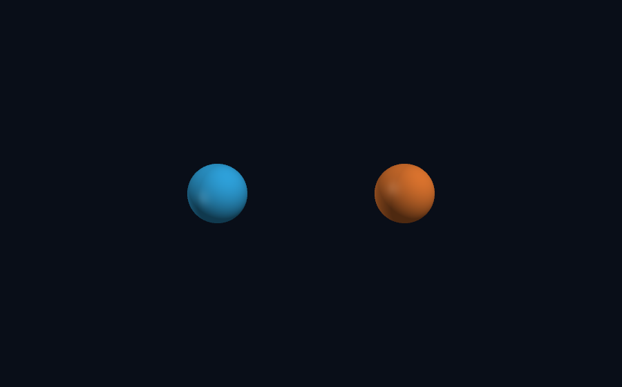

# Molecular experiments

Every example executes itself and writes into the current working directory. `examples/render-all.sh`
rebuilds this gallery. The pipeline is OpenMM computation -> CSV -> `lmplot` (curves, dashboards),
`lmcad` (3D renders, animation frames) or `lmdraw` (annotated schematics). Each caption's
`lmctl autorun` line reproduces the picture from an empty directory.

## Liquids, crystals and phase behaviour

### Argon g(r) in three phases

The same 256 Lennard-Jones atoms at 40 K / 1.69 g/cm³ (FCC shells at a/sqrt(2), a, ...), at Rahman's
liquid state point (94.4 K, 1.374 g/cm³: one sharp first shell, damped second) and as a 300 K gas
(g = 1 beyond contact). [Source](../examples/stories/argon_rdf_phases.lms) `lmctl https://raw.githubusercontent.com/lmctl-ai/lmmolecule/main/examples/stories/argon_rdf_phases.lms`

### Self-diffusion from the Einstein relation

MSD(t) under NVE after Langevin equilibration; gnuplot fits 6Dt on 4-20 ps and D comes back into the
script through `plot.num`. Result 2.5e-5 cm²/s against Rahman's 2.43e-5 (1964).
[Source](../examples/stories/diffusion_msd.lms) `lmctl https://raw.githubusercontent.com/lmctl-ai/lmmolecule/main/examples/stories/diffusion_msd.lms`

### Liquid density under a barostat

256 atoms placed as a random gas at 0.97 g/cm³ shrink under the Monte Carlo barostat at 1 bar and
94.4 K to 1.35 g/cm³ (measured 1.374); the long-range dispersion correction is on, without it the
density is 4 % lower. [Source](../examples/stories/npt_density.lms) `lmctl https://raw.githubusercontent.com/lmctl-ai/lmmolecule/main/examples/stories/npt_density.lms`

### Maxwell-Boltzmann speeds

6000 speeds from 1000 BAOAB-Langevin argon atoms at 300 K, binned by gnuplot, against the analytic
f(v); most probable speed 353 m/s, mean 399 m/s.
[Source](../examples/stories/maxwell_boltzmann.lms) `lmctl https://raw.githubusercontent.com/lmctl-ai/lmmolecule/main/examples/stories/maxwell_boltzmann.lms`

### Melting a crystal

108 atoms heated in 24 Langevin stages at fixed volume; lmcad renders each frame (colour follows the
bath temperature), ffmpeg assembles the GIF, the still shows the first and last frame with U/N.
[Source](../examples/stories/argon_melt.lms) `lmctl https://raw.githubusercontent.com/lmctl-ai/lmmolecule/main/examples/stories/argon_melt.lms`

### Minimized FCC argon

Coordinates in nm; illustrative sphere radii. [Source](../examples/visual/argon_structure.lms) `lmctl https://raw.githubusercontent.com/lmctl-ai/lmmolecule/main/examples/visual/argon_structure.lms`

### Thermostatted argon crystal

L-BFGS minimization (-7.7 kJ/mol per atom) and 120 K Langevin equilibration of 108 atoms.
[Source](../examples/argon_fcc_melt.lms) `lmctl https://raw.githubusercontent.com/lmctl-ai/lmmolecule/main/examples/argon_fcc_melt.lms`

## Water

### 216 TIP3P molecules

Rigid TIP3P with PME at 300 K: O-O first peak at 2.75 Å, O-H hydrogen-bond peak at 1.85 Å,
temperature over 1296 constrained degrees of freedom, U/N about -40 kJ/mol (Jorgensen 1983: -41.1).
The render wraps every molecule into the cell. [Source](../examples/stories/water_box.lms) `lmctl https://raw.githubusercontent.com/lmctl-ai/lmmolecule/main/examples/stories/water_box.lms`

### The water dimer

Minimized rigid dimer: -6.46 kcal/mol at R(O-O) = 2.75 Å with an almost linear hydrogen bond
(Jorgensen 1983: -6.50 kcal/mol at 2.74 Å). The scan slides the acceptor along the O-O axis.
[Source](../examples/stories/water_dimer.lms) `lmctl https://raw.githubusercontent.com/lmctl-ai/lmmolecule/main/examples/stories/water_dimer.lms`

### Forces on a bent molecule

Harmonic bonds and angle; only the angle term is strained, the three forces sum to zero and
minimization reopens the angle to 113.2 degrees.
[Source](../examples/stories/water_forces.lms) `lmctl https://raw.githubusercontent.com/lmctl-ai/lmmolecule/main/examples/stories/water_forces.lms`

### Water bending

A harmonic angle model at fixed O-H lengths, not a complete water force field. [Source](../examples/visual/water_bend.lms) `lmctl https://raw.githubusercontent.com/lmctl-ai/lmmolecule/main/examples/visual/water_bend.lms`

## Bonds, integrators and time steps

### Time-step convergence

Morse bond with a 33.8 fs period: the energy error grows as dt² and the integration fails near the
stability limit 2/omega = 10.8 fs. [Source](../examples/stories/timestep_convergence.lms) `lmctl https://raw.githubusercontent.com/lmctl-ai/lmmolecule/main/examples/stories/timestep_convergence.lms`

### Anharmonic period

Measured Morse periods follow T0/sqrt(1 - E/De) within 1 %; a harmonic bond with the same curvature
keeps T0 at every amplitude. [Source](../examples/stories/morse_period.lms) `lmctl https://raw.githubusercontent.com/lmctl-ai/lmmolecule/main/examples/stories/morse_period.lms`

### Energy exchange and conservation

Two hosts in one script (`lmmolecule` integrates, `lmplot` draws), and the original NVE check.
[Source](../examples/combo/morse_plot.lms) `lmctl https://raw.githubusercontent.com/lmctl-ai/lmmolecule/main/examples/combo/morse_plot.lms` 
[Source](../examples/morse_dimer.lms) `lmctl https://raw.githubusercontent.com/lmctl-ai/lmmolecule/main/examples/morse_dimer.lms`

### Anharmonic bond motion

A stretched Morse dimer under NVE Verlet; 48 computed frames at 12 fps assembled by `ffmpeg` from
lmcad PNG frames. [Source](../examples/visual/morse_motion.lms) `lmctl https://raw.githubusercontent.com/lmctl-ai/lmmolecule/main/examples/visual/morse_motion.lms`

### Mass and vibration

Identical harmonic force constants with particle masses 1 and 4 amu. [Source](../examples/visual/isotope_oscillation.lms) `lmctl https://raw.githubusercontent.com/lmctl-ai/lmmolecule/main/examples/visual/isotope_oscillation.lms`

### Lennard-Jones binding

Pair energies across separation: the well of depth epsilon at 2^(1/6) sigma and the repulsive wall.
[Source](../examples/visual/lj_binding.lms) `lmctl https://raw.githubusercontent.com/lmctl-ai/lmmolecule/main/examples/visual/lj_binding.lms`

### Butane

Energy before and after minimization, and the orange initial / teal relaxed united-atom chains.
[Source](../examples/butane_torsion.lms) `lmctl https://raw.githubusercontent.com/lmctl-ai/lmmolecule/main/examples/butane_torsion.lms` 
[Source](../examples/visual/butane_relaxation.lms) `lmctl https://raw.githubusercontent.com/lmctl-ai/lmmolecule/main/examples/visual/butane_relaxation.lms`

## Thermostats and ensembles

### NVE, Langevin and Andersen

108 argon atoms started at 20 K with a 120 K bath: Langevin relaxes at the friction rate, Andersen at
the collision rate, NVE keeps its own energy. [Source](../examples/stories/thermostat_comparison.lms) `lmctl https://raw.githubusercontent.com/lmctl-ai/lmmolecule/main/examples/stories/thermostat_comparison.lms`

### Langevin thermal sampling

Kinetic and potential energy fluctuations for one particle in a 300 K bath. [Source](../examples/visual/thermal_trap.lms) `lmctl https://raw.githubusercontent.com/lmctl-ai/lmmolecule/main/examples/visual/thermal_trap.lms`

## Lattices and electrostatics

### Phonon dispersion

Each of the 16 modes of a 32-atom harmonic ring is excited alone and its frequency measured from
zero crossings; all lie on omega(k) = 2 sqrt(K/m) |sin(ka/2)| within 3 %.
[Source](../examples/stories/phonon_dispersion.lms) `lmctl https://raw.githubusercontent.com/lmctl-ai/lmmolecule/main/examples/stories/phonon_dispersion.lms`

### Madelung constant

512-ion rock-salt cell with particle-mesh Ewald: M = 1.747567 against 1.7475646.
[Source](../examples/nacl_madelung.lms) `lmctl https://raw.githubusercontent.com/lmctl-ai/lmmolecule/main/examples/nacl_madelung.lms`

### Rock-salt lattice

Blue Na+, green Cl-. Coordinates come from the charged lattice builder. [Source](../examples/visual/nacl_structure.lms) `lmctl https://raw.githubusercontent.com/lmctl-ai/lmmolecule/main/examples/visual/nacl_structure.lms`
